# Space Shuttle Vessel
Space Shuttle Vessel (SSV) is an addon for Orbiter Space Flight Simulator (https://github.com/orbitersim/orbiter). The purpose of this addon is to simulate NASA’s Space Transportation System Program as much as possible. Currently only some elements have been completed and work on others is ongoing.

This release of SSV is for use in [Orbiter 2027 Linux](https://github.com/racerx2/orbiter-2027-linux).

# Space Shuttle Vessel, native on Linux
Fly the Space Shuttle on Linux. No Wine, no virtual machine: this fork runs SSV natively in [Orbiter Linux](https://github.com/racerx2/orbiter-2027-linux) with its Vulkan graphics, and it adds features you won't find in the Windows release.

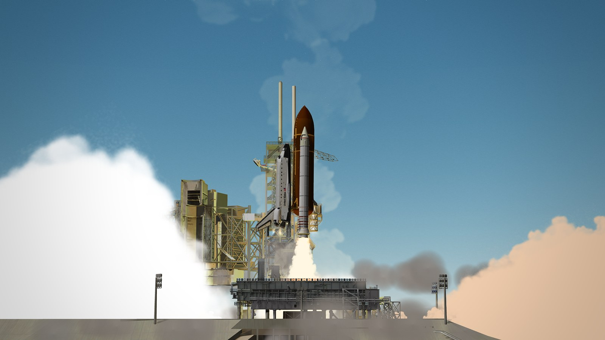

## Why fly it here
- **The whole shuttle, natively.** The orbiter, ET and SRBs, the pads, MLP, crawler, VAB and LCC, the full virtual cockpit with every display and the HUD, from the countdown to wheel stop.
- **Real aborts.** Engine out on the way up? Turn the ABORT MODE knob, press ABORT, and the flight software takes it from there, as it did on the real shuttle: Abort to Orbit and Abort Once Around targeting, the OMS and RCS propellant dumps, the OMS/RCS interconnect and the abort displays. Lose the center engine nearly six minutes in and still make orbit. (TAL and RTLS are next.)
- **Launches that look the part.** Billowing SRB smoke on the pad, plumes that fan out in the thin upper air, and SRB separation in a cloud of exhaust.
- **Physically based materials.** The SRBs are drawn with Orbiter Linux's PBR material system: metal-roughness paint under a glossy clear coat, lit by the scene's own environment reflections, so the satin finish catches the sun and the sky the way painted steel does. It is all set in `Config/GC/SSV_SRB.cfg` on top of SSV's own textures, no new art, and any add-on can do the same with the client's `PBR_*` material keys.
- **Fiery entries.** The belly and nose cap glow through the plasma as you come home.
- **A cockpit that comes alive.** Power up the HUD and its glass glows green, bright enough to see from outside through the windshield. The display screens catch the light like real glass, and the cockpit textures are cleaned up.
- **The pads as they were.** Orbiter Linux streams real-world 3D buildings and trees around you. SSV keeps the shuttle-era sites at LC-39A, LC-39B and SLC-6 clear, so today's towers never stand next to your stack.
- **Solid ground.** With Orbiter Linux's Collision module the pads, VAB and LCC are real structures: the stack never shoves them aside, and the umbilicals let go cleanly at liftoff.
- **Replay your flights.** Record with Orbiter's flight recorder (Ctrl+C) and SSV records the crew too: every switch, breaker, knob, MDU key, hand controller, pad and crawler command. Play it back and the cockpit works itself, with the recorded flight's random values, so the replay trips the same holds and cautions as the original flight.

## Screenshots
| | |
|---|---|
| 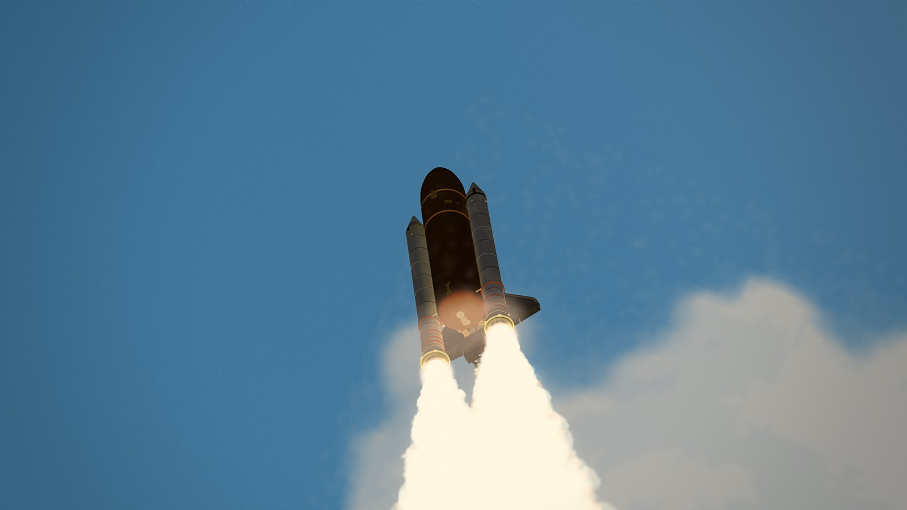 Clearing the tower | 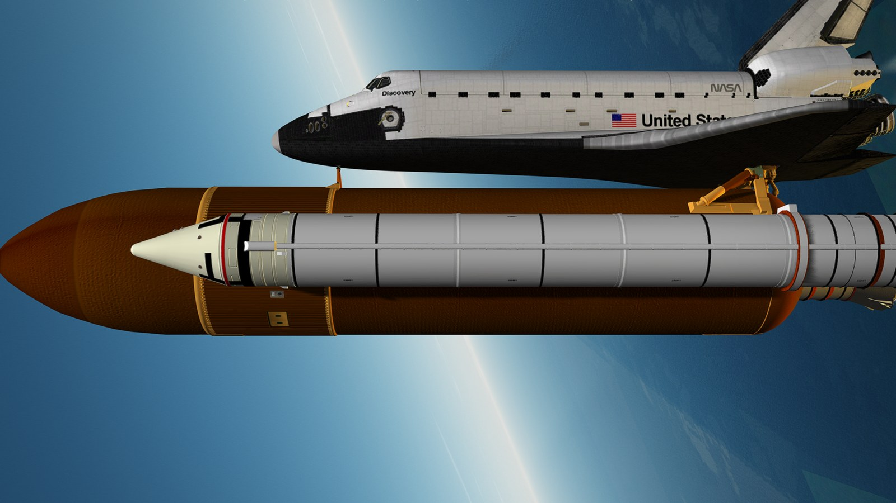 Satin paint on the SRBs, T+35 s |
| 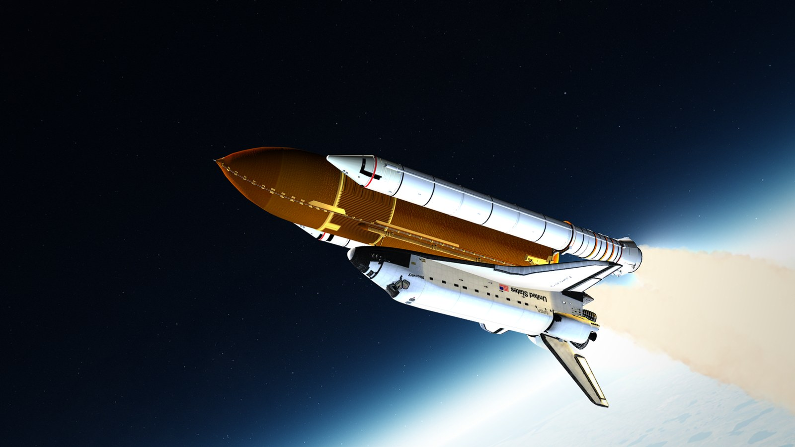 T+110 s, plumes spreading in thin air | 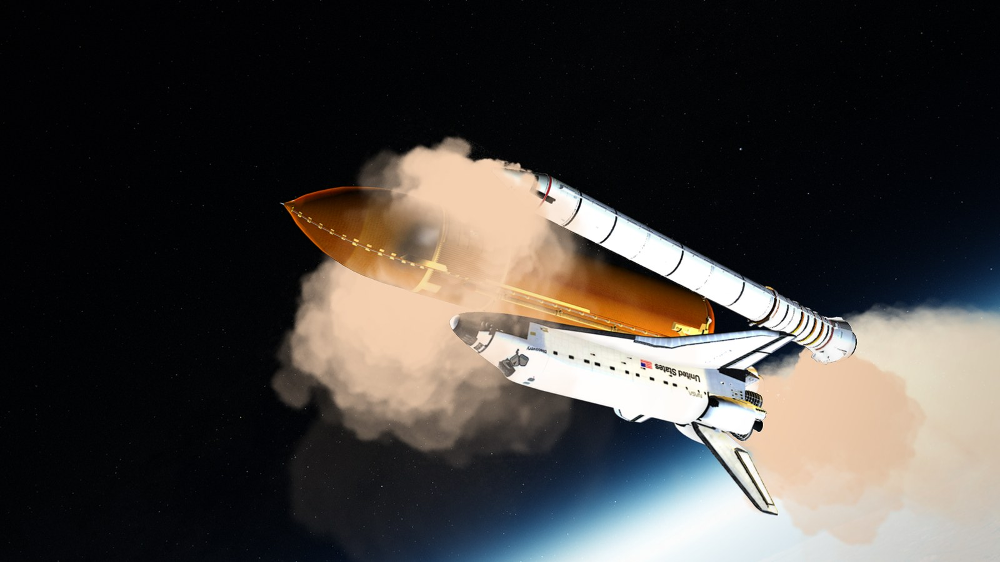 SRB separation |
| 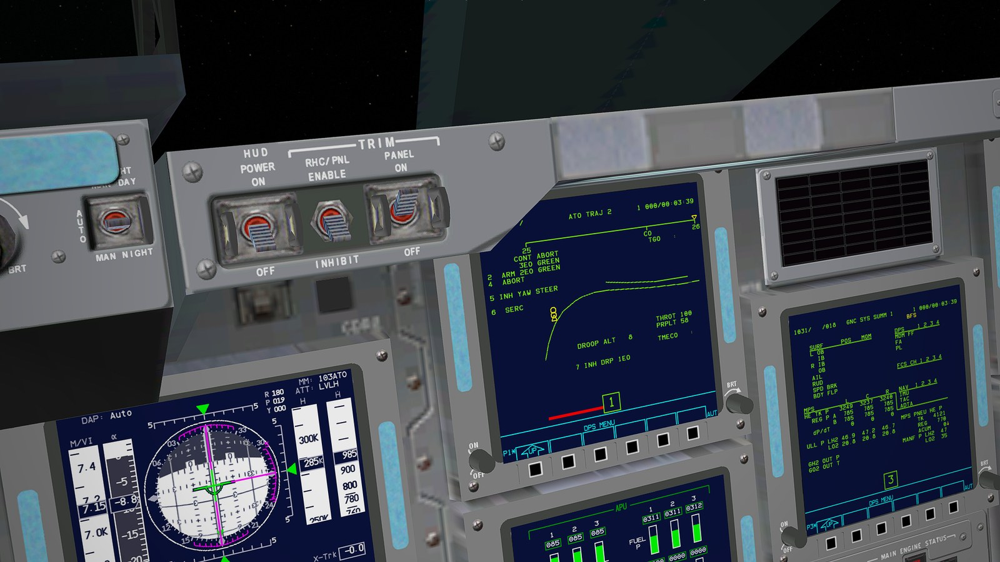 Abort to Orbit: ATO TRAJ 2 in MM 103 | 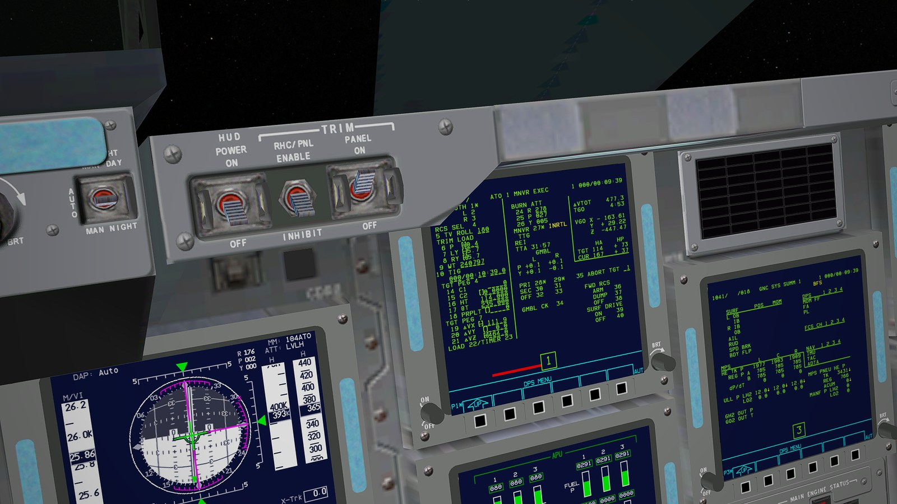 ATO OMS-1 targets loaded on their own |
| 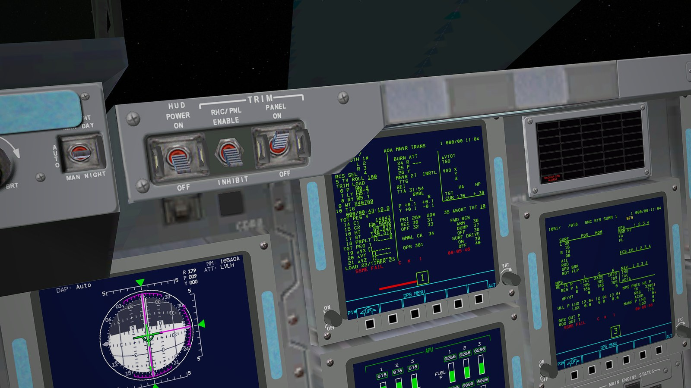 Abort Once Around: OPS 301 flashing | 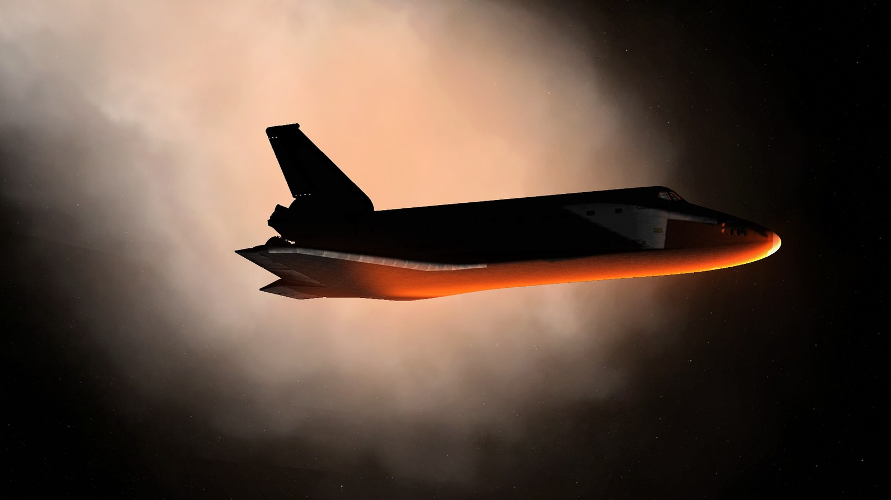 Entry heating |
| 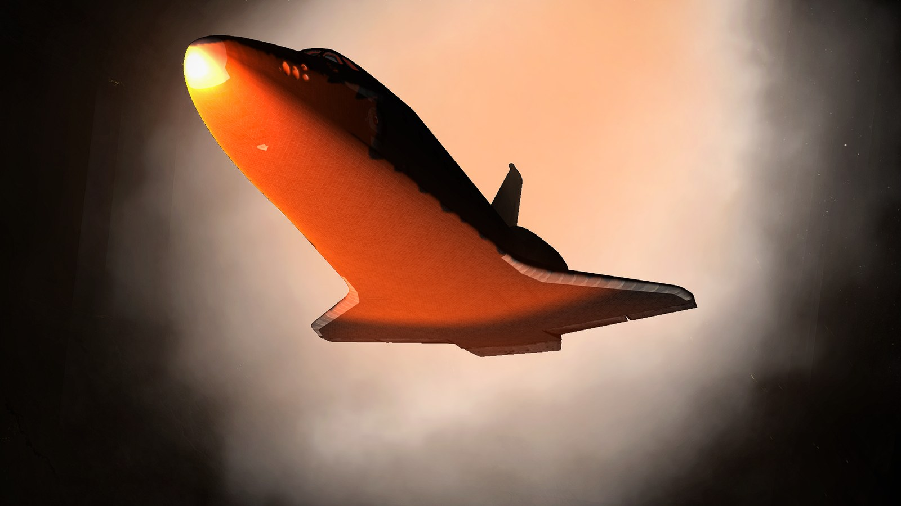 Nose cap and belly at peak heating | 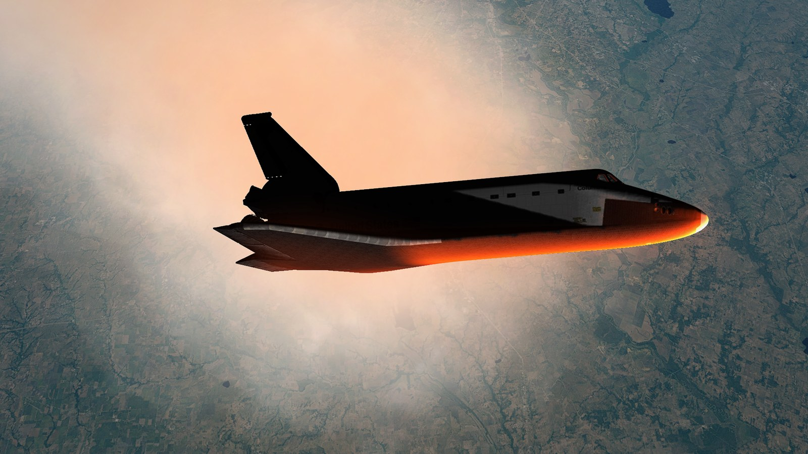 Plasma over land in daylight |
| 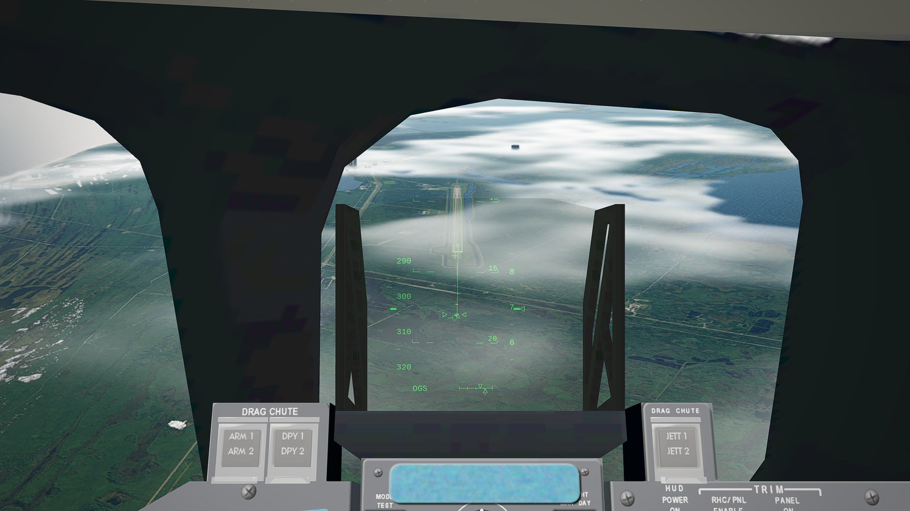 Final approach to KSC runway 15 on the HUD | 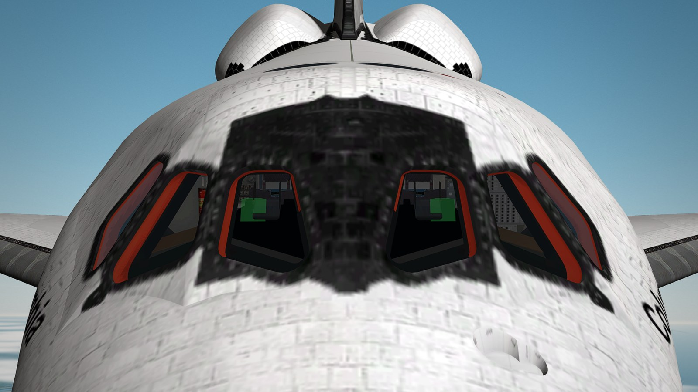 The HUD glass glowing through the windshield |

## Get flying
1. Install [Orbiter Linux](https://github.com/racerx2/orbiter-2027-linux).
2. Extract `SSV-1.16-linux-1.0-x64.zip` into your Orbiter folder.
3. From that folder, run once: `python3 "Install/Space Shuttle Vessel/ssv_linux_setup.py"`. It adds SSV's bases and pad scenery to Orbiter's configuration, and running it again is harmless.
4. Start Orbiter and pick a scenario under **Space Shuttle Vessel**.

The details, the settings SSV likes and how to remove it are in [`linux/SSV-Linux.txt`](linux/SSV-Linux.txt) (in the zip: `Doc/Space Shuttle Vessel/SSV-Linux.txt`).

## Build it yourself
CMake 3.19+, Ninja, GCC and Qt 6: `cmake -S . -B out/build -G Ninja -DORBITER_ROOT=<Orbiter folder>`, then `cmake --build out/build`. The Orbiter SDK libraries come from Orbiter's CMake package (`Orbitersdk/lib/cmake/Orbiter` in the Orbiter folder). The sources and the mesh and COMPOOL header generators come from the Visual Studio projects (`linux/vcxproj.py`). `linux/mkpkg.py out/build <manual.pdf|-> out` makes the zip.

## About this port
Space Shuttle Vessel is by the SSV team (GLS and indy91). This Linux port and its additions are by racerx2. It is unofficial and not supported by the SSV team, so please report problems with it to racerx2, not to them. Every Linux change in the code is marked `not upstream`, and the Windows code stays as it is under `#ifdef _WIN32`. Same licence as SSV: GNU GPL v2.

# Installation on Windows (the original SSV release, Orbiter 2024)
1. Install Orbiter 2024.

2. Install the required addons:

	Antelope Valley scenery pack (https://www.orbiter-forum.com/resources/orbiter-2016-high-resolution-texture-packs.5676/)

3. Extract the SSV files into your Orbiter installation folder, overwriting any existing files.
WARNING: The SSV installation overwrites the default Base.cfg and Earth.cfg files.

4. Install the "SSV_Font_A" and "SSV_Font_B" fonts, located in the "<Orbiter installation>\Install\Space Shuttle Vessel" directory, by opening them and selecting "Install". After successful installation the files can be deleted.

5. The displays in SSV require the MFD resolution of 512 x 512 (Orbiter Launchpad > Extra > Instruments and panels > MFD parameter configuration > MFD texture size).

6. The local light sources have to be enabled for the external lights in SSV to work (Orbiter Launchpad > Visual effects > Local light sources, and additionally in D3D9 Orbiter Launchpad > Video > Advanced > Local lights).

7. For a better visual experience, using the D3D9 graphics client is strongly recommended, although not required. If using the D3D9 graphics client, the "Disable near clip plane compatibility mode" option in the D3D9 Advanced Setup dialog (Orbiter Launchpad > Video > Advanced) should be checked.

NOTE: If you encounter the error "msvcp140.dll is missing" you need to download the Microsoft Visual C++ Redistributable for Visual Studio 2017.

## Optional addons
It is recommended the installation of the excellent Shuttle FDO MFD (https://github.com/indy91/Shuttle-FDO-MFD) by indy91, which performs the calculations done by the Flight Dynamics Officers in Mission Control, allowing an accurate rendezvous profile simulation, as well as targeting a deorbit burn to land at a chosen runway.

## Known issues
A compatibility issue has been identified with the addon "Attachment Manager", so it might have to be disabled for SSV to work properly.

# Credits
Space Shuttle Vessel is based on revision 3242 of Space Shuttle Ultra (svn://orbiter-radio.co.uk/shuttleultra).

The SSV vessels load JSON files with cJSON library by Dave Gamble and cJSON contributors (https://github.com/DaveGamble/cJSON), included in the code. The Mission Editor loads and saves JSON files with Json.NET by James Newton-King (https://www.newtonsoft.com/json).

Large parts of the launch autopilot were copied (with minor modifications) from PEG MFD.

Some of the attitude control code was derived from Attitude MFD V3.

Vandenberg base uses part of the VandenbergAFB-2006 addon (https://www.orbiter-forum.com/resources/vandenbergafb-2006.3523/) by Usonian.

The SurfaceRoving class is based on the GeneralVehicle addon (https://www.orbiter-forum.com/resources/generalvehicle.3158/) by Fred18.

The file "circuit_breaker.wav" comes from Project Apollo - NASSP (https://github.com/orbiternassp/NASSP).

# License
This addon is open-source and is released under the GNU GPL v2 (see file [SSV-LICENSE.txt](SSV-LICENSE.txt) for details).

# Disclaimer
The SSV team is not responsible for any crashes or other problems caused by this addon. Use at your own risk.
